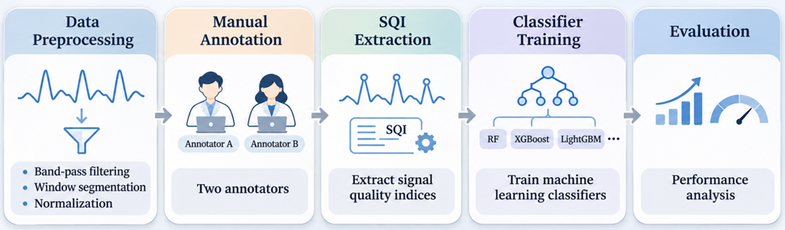
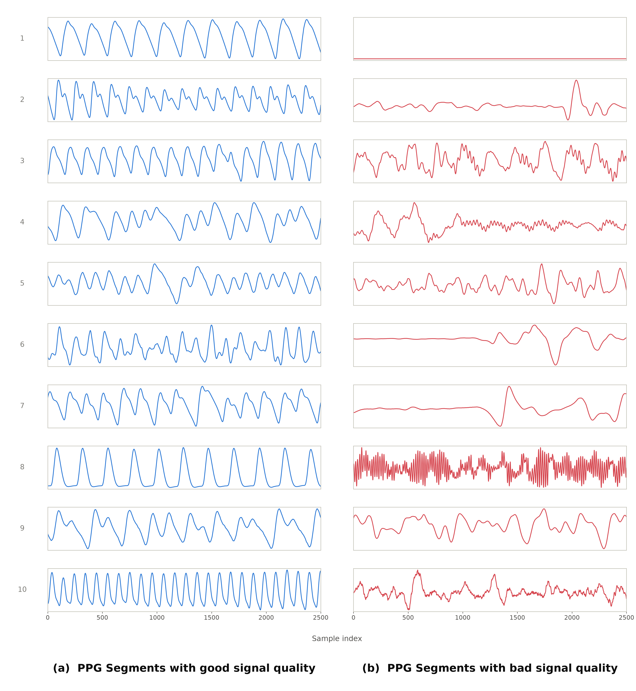
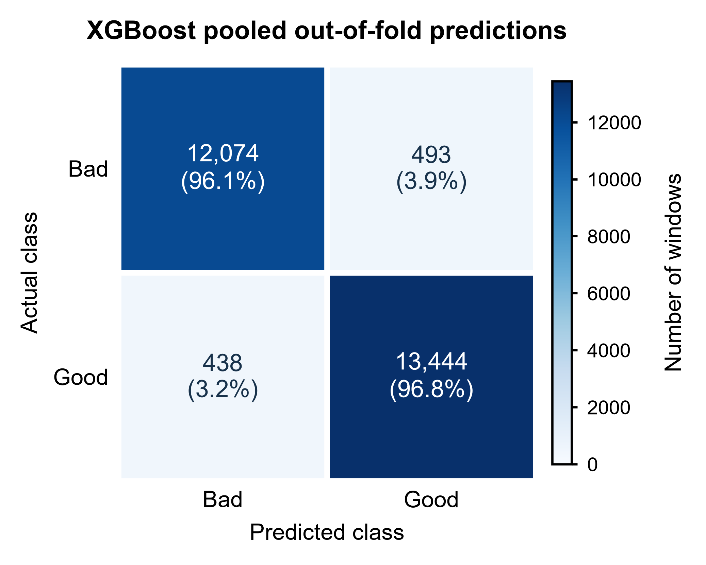

# PPG Signal Quality Assessment

## 1. Introduction

The quality of photoplethysmography (PPG) signals directly affects the reliability of subsequent rhythm analysis. Motion artifacts, poor sensor contact, clipping, and signal interruptions can introduce spurious pulse peaks or obscure genuine beats. Reliable quality assessment is therefore essential for rejecting corrupted windows while retaining physiologically informative signals, including those recorded during atrial fibrillation (AF).

Previous studies have used different quality labels, signal quality indices (SQIs), window lengths, and annotation protocols [5]–[9]. AF-related beat-to-beat variability further complicates quality assessment because it may resemble artifact-induced waveform distortion [8]. Accordingly, this study evaluates whether a unified representation comprising 21 SQIs can distinguish good-quality (Good) from poor-quality (Bad) PPG windows while retaining usable AF windows.

The objectives were to 1) construct a binary Good/Bad dataset using windows for which two annotators agreed and 2) compare five SQI-based classifiers using nested cross-validation grouped by recording. XGBoost feature importance was also analyzed to determine whether gain-based feature selection could reduce the number of features while maintaining classification performance.

## 2. Methods

### 2.1 Experimental Workflow

The experimental workflow comprised six stages: preprocessing and windowing, manual quality annotation, SQI extraction, classifier training, and record-grouped evaluation. The complete workflow is summarized in Fig. 1.

**Fig. 1. Experimental workflow for PPG signal-quality assessment.** The diagram shows the preprocessing operations, concordant manual labeling, 21-feature SQI extraction, classifier training, and nested evaluation protocol.

<p align="center">
  
</p>

### 2.2 Data and Preprocessing

Four datasets were combined to include clinical PPG recordings, long-term wrist monitoring, pulse oximetry recordings with reference annotations, and wearable recordings affected by motion artifacts.

- **PPGArrhythmia [1]:** PPG was acquired in a clinical surgical setting using a commercial patient monitor and a finger-clip pulse-oximetry probe. The recordings were comparatively clean and included AF labels.
- **Long-Term ECG and Wrist-Based PPG [2]:** Simultaneous wrist PPG and reference ECG were recorded from 45 patients with suspected AF for 5–8 days. Recording continued from the hospital into the home environment, thereby including disturbances typical of prolonged wearable monitoring. AF episodes were identified from the reference ECG.
- **CapnoBase [3]:** This dataset contains 42 eight-minute pulse-oximetry PPG recordings with reference physiological signals and expert-validated pulse-peak and artifact annotations.
- **Wrist PPG During Exercise [4]:** Wrist PPG was recorded from eight participants during walking, running, and stationary cycling. Synchronized accelerometer and gyroscope signals characterized sensor motion, while chest ECG provided cardiac timing.

Each PPG recording was resampled to 250 Hz, bandpass filtered between 0.5 and 10 Hz, and divided into nonoverlapping 10-s windows containing $`N=2500`$ samples each. Each window was then independently normalized to $`[0,1]`$. A subset of these windows was selected for manual quality annotation, as described below.

### 2.3 Manual Signal Quality Annotation

Manual quality annotation was performed on a subset of the 10-s PPG windows from the four datasets. Two annotators independently labeled each selected window as Good or Bad using the criteria described by Pereira et al. [8]. A window was labeled Good if it reflected the blood volume pulse associated with the underlying physiological or pathophysiological state, exhibited a consistent number of waveform inflection points, and contained no artifacts or irregular morphologies unexplained by the reference rhythm. A window was labeled Bad when these conditions were not satisfied, including cases in which motion artifacts, contact loss, clipping, interruption, or severe noise prevented reliable pulse identification. AF-related beat-to-beat irregularity was not considered evidence of poor quality when it was physiologically consistent with the reference rhythm.

Only annotated windows for which both annotators agreed were retained for subsequent analysis. The reference ECG provided physiological context during annotation and was used to define rhythm subgroups; it was not used as an input to the PPG quality classifiers [8].

### 2.4 Signal Quality Indices

Twenty-one SQIs were extracted from each retained 10-s window to characterize the amplitude distribution, temporal variability, periodicity, spectral characteristics, signal complexity, and pulse morphology. Explicit definitions are provided because SQI values depend on preprocessing, window duration, peak detection, and amplitude normalization [5]–[9].

Let $`x_i`$ denote the $`i`$th sample in a window of length $`N=2500`$. The sample mean, central moment of order $`r`$, population standard deviation, and robust amplitude range were defined as

```math
\bar{x}=\frac{1}{N}\sum_{i=1}^{N}x_i,\qquad
m_r=\frac{1}{N}\sum_{i=1}^{N}(x_i-\bar{x})^r,\qquad
\sigma_x=\sqrt{m_2},\qquad
A=P_{95}(x)-P_5(x),
```

where $`P_q(x)`$ denotes the $`q`$th percentile of the sample amplitudes.

Systolic peaks were detected from each preprocessed window at 250 Hz using the Elgendi method implemented in NeuroKit2 as `ppg_findpeaks()` [10], [11]. The detected peak indices were denoted by

```math
\mathcal{P}=\{\tau_j\}_{j=1}^{J},
```

where $`J=|\mathcal{P}|`$ is the number of detected systolic peaks. The same peak set was used for NDP, MPP, PPI-CV, ATMC, CPP, ED, and RBTC.

1. **Normalized median absolute deviation (nMAD).** nMAD measures the typical deviation of the samples from the median and is less sensitive to isolated extreme values than standard deviation. It describes relative amplitude variability and is defined as

```math
\mathrm{nMAD}=\frac{\mathrm{median}_{i}\lvert x_i-\widetilde{x}\rvert}{A+10^{-6}},\qquad
\widetilde{x}=\mathrm{median}_{i}(x_i).
```

2. **Amplitude Shannon entropy (ShanEn).** ShanEn measures the uncertainty of the amplitude distribution. A more dispersed distribution produces higher entropy and may indicate increased waveform variability or noise. The amplitude distribution was estimated using a histogram with 100 bins, and ShanEn was calculated as

```math
\mathrm{ShanEn}=-\sum_{b:p_b>0}p_b\ln p_b,
```

where $`p_b`$ is the proportion of samples in the $`b`$th bin.

3. **Skewness.** Skewness measures the asymmetry of the amplitude distribution. Changes in pulse morphology or asymmetric artifacts can alter this distribution and therefore help distinguish signals of different quality. It is defined as

```math
\mathrm{Skewness}=\frac{m_3}{m_2^{3/2}}.
```

4. **Number of detected peaks (NDP).** NDP is the number of detected systolic peaks. Too few or too many peaks may indicate missed pulses, false detections, or severe waveform distortion. It is defined as

```math
\mathrm{NDP}=J=|\mathcal{P}|.
```

5. **Mean peak prominence (MPP).** MPP describes how distinctly the detected systolic peaks rise above their surrounding baseline. For each detected peak, the prominence $`\pi_j`$ was calculated as the peak amplitude minus the higher of its left and right bases. MPP is defined as

```math
\pi_j=x_{\tau_j}-\max\!\left(b_j^{(L)},b_j^{(R)}\right),\qquad
\mathrm{MPP}=\begin{cases}
\dfrac{1}{J}\sum_{j=1}^{J}\pi_j,&J>0,\\[4pt]
0,&J=0,
\end{cases}
```

where $`b_j^{(L)}`$ and $`b_j^{(R)}`$ are the left and right base amplitudes of peak $`j`$, respectively.

6. **Coefficient of variation of pulse peak intervals (PPI-CV).** PPI-CV measures the variability of consecutive pulse-peak intervals relative to their mean. It describes temporal irregularity, although both physiological rhythm irregularity and signal artifacts can increase its value. Let $`d_j=\tau_{j+1}-\tau_j`$ and $`M=J-1`$. The feature is defined as

```math
\mathrm{PPI\text{-}CV}=
\frac{\sqrt{\dfrac{1}{M}\sum_{j=1}^{M}(d_j-\bar d)^2}}{\bar d},\qquad
\bar d=\frac{1}{M}\sum_{j=1}^{M}d_j.
```

When fewer than two peaks were detected, PPI-CV was treated as missing. With exactly two peaks, only one interval is available and the population standard deviation is zero.

7. **Dominant power ratio (DPR).** DPR measures the proportion of total spectral power contained in the strongest frequency bin. A larger value indicates stronger spectral concentration, whereas a smaller value indicates that power is distributed more broadly. It is defined as

```math
\mathrm{DPR}=\frac{\max_k P_k}{\sum_k P_k}.
```

The periodogram was calculated with its sampling-frequency argument set to $`f_s=1`$; consequently, DPR is a discrete spectral-concentration measure rather than power within a physiologically specified frequency band.

8. **Spectral entropy (SpEn).** SpEn measures how evenly signal power is distributed across frequency bins. Low entropy indicates a concentrated spectrum, whereas high entropy indicates a diffuse spectrum that may contain irregular fluctuations or noise. Defining $`q_k=P_k/\sum_kP_k`$ and letting $`K`$ be the number of included frequency bins, it is calculated as

```math
\mathrm{SpEn}=-\frac{\sum_{k:q_k>0}q_k\ln q_k}{\ln K}.
```

9. **Maximum autocorrelation peak (MAC).** MAC measures the strength of repeated waveform patterns within the window. A high value indicates that similar pulse shapes recur at a consistent lag, whereas a low value suggests weak periodicity or substantial distortion. For the detrended sequence $`y_i`$ and $`L=\max(2,\lfloor N/100\rfloor)`$, it is defined as

```math
r(\ell)=\frac{\sum_{i=1}^{N-\ell}y_i y_{i+\ell}}{\sum_{i=1}^{N}y_i^2},\qquad
\mathrm{MAC}=\max_{\ell\in\mathcal{L}}r(\ell),
```

where $`\mathcal{L}=\{\ell:L\leq\ell<N/2,\ r(\ell)\text{ is a local maximum}\}`$. MAC was set to zero when no eligible autocorrelation peak was present.

10. **Second-difference root mean square (SDRMS).** SDRMS measures rapid changes in the local slope of the waveform. Large values indicate sharp, high-frequency fluctuations that may arise from noise or motion artifacts. It is defined as

```math
\mathrm{SDRMS}=\frac{\sqrt{\dfrac{1}{N-2}\sum_{i=1}^{N-2}(x_{i+2}-2x_{i+1}+x_i)^2}}{\sigma_x+10^{-9}}.
```

11. **Mean absolute first difference (MAFD).** MAFD measures the average sample-to-sample amplitude change relative to the overall variation of the window. Larger values indicate faster fluctuations and may reflect abrupt waveform changes or high-frequency noise. It is defined as

```math
\mathrm{MAFD}=\frac{\dfrac{1}{N-1}\sum_{i=1}^{N-1}|x_{i+1}-x_i|}{\sigma_x+10^{-9}}.
```

12. **Zero-crossing rate (ZCR).** ZCR indicates how often the signal changes from one side of its median level to the other. Frequent crossings reflect rapid amplitude fluctuations and may indicate high-frequency noise. Crossings were defined relative to the window median rather than the physical zero-amplitude level:

```math
\mathrm{ZCR}=\frac{1}{N}\sum_{i=1}^{N-1}\mathbf{1}\big[(x_i-\widetilde{x})(x_{i+1}-\widetilde{x})<0\big].
```

13. **Robust amplitude range (RAR).** RAR measures the spread of the central 90% of sample amplitudes. It describes the effective dynamic range while reducing sensitivity to isolated extreme values. It is defined as

```math
\mathrm{RAR}=P_{95}(x)-P_5(x).
```

14. **Standard deviation (SD).** SD measures the overall dispersion of the signal amplitudes around their mean. It reflects the magnitude of amplitude variation within the window and is defined as

```math
\mathrm{SD}=\sqrt{\frac{1}{N}\sum_{i=1}^{N}(x_i-\bar{x})^2}.
```

15. **Adaptive-template mean correlation (ATMC).** ATMC measures the morphological consistency of detected pulses. A higher value indicates that individual beats resemble the average pulse template, whereas a lower value indicates greater beat-to-beat shape variation or distortion. The beat length $`T`$ was set to the median interval between consecutive peaks. Complete peak-centered beat segments $`b_j[k]`$ were averaged pointwise to obtain the template $`\bar b[k]`$. ATMC was then calculated as

```math
\bar b[k]=\frac{1}{B}\sum_{j=1}^{B}b_j[k],\qquad
\mathrm{ATMC}=\frac{1}{B}\sum_{j=1}^{B}
\frac{\sum_k(b_j[k]-\bar b_j)(\bar b[k]-\bar{\bar b})}
{\sqrt{\sum_k(b_j[k]-\bar b_j)^2\sum_k(\bar b[k]-\bar{\bar b})^2}},
```

where $`B`$ is the number of valid beats, $`\bar b_j`$ is the mean of beat $`j`$, and $`\bar{\bar b}`$ is the mean of the template. ATMC required at least three detected peaks and two complete beat segments; otherwise, it was treated as missing.

16. **Kurtosis.** Kurtosis measures the tail weight and peakedness of the amplitude distribution. It is sensitive to unusually large values and can therefore indicate waveform distortion. Using the Pearson convention, for which a normal distribution has a value of three, it is defined as

```math
\mathrm{Kurtosis}=\frac{m_4}{m_2^2}.
```

17. **Fuzzy entropy (FuzzyEn).** FuzzyEn measures waveform regularity and complexity by comparing short signal patterns. Higher values indicate less repeatable patterns, which may arise from irregular morphology or noise. After standardization, embedded vectors were constructed using $`m=2`$, $`r=0.2`$, and $`n=2`$. For the Chebyshev distance $`D_{ij}^{(m)}`$ between two vectors, excluding self-matches, it is defined as

```math
\mu_{ij}^{(m)}=\exp\!\left[-\left(\frac{D_{ij}^{(m)}}{r}\right)^n\right],\qquad
\phi(m)=\frac{1}{Q_m}\sum_{i\ne j}\mu_{ij}^{(m)},\qquad
\mathrm{FuzzyEn}=-\ln\frac{\phi(m+1)}{\phi(m)},
```

where $`Q_m`$ is the number of non-self vector pairs included in the average.

18. **Lempel-Ziv complexity (LZC).** LZC quantifies the complexity of the signal based on the emergence of new subsequences. A repetitive waveform produces a lower value, whereas an irregular or noise-like waveform produces a higher value. The window was binarized about its median, $`s_i=\mathbf{1}(x_i>\widetilde{x})`$, and the number of newly encountered subsequences was denoted by $`c(N)`$. It is defined as

```math
\mathrm{LZC}=\frac{c(N)\log_2N}{N}.
```

19. **Cardiac pulse power (CPP).** CPP measures the mean squared amplitude of the detected pulse waveforms after amplitude normalization. Samples between adjacent detected peaks formed beat $`b_j`$ of length $`L_j`$, and the mean power across the $`B`$ valid beats is defined as

```math
\mathrm{CPP}=\frac{1}{B}\sum_{j=1}^{B}\left(\frac{1}{L_j}\sum_{k=1}^{L_j}b_j[k]^2\right).
```

20. **Mean beat-to-template Euclidean distance (ED).** ED measures how far each pulse waveform deviates from the average pulse template. A larger distance indicates greater morphological inconsistency and may reflect waveform distortion. Each inter-peak beat was linearly resampled to the median beat length $`L`$, and the aligned beats were averaged to form the template $`\bar b[k]`$. It is defined as

```math
\mathrm{ED}=\frac{1}{B}\sum_{j=1}^{B}\sqrt{\sum_{k=1}^{L}(b_j[k]-\bar b[k])^2}.
```

21. **Resampled beat-template correlation (RBTC).** RBTC measures the shape similarity between individual pulses and the average template after differences in beat duration have been removed by linear resampling. A higher value indicates more consistent pulse morphology. Using the resampled beats and template defined for ED, it is calculated as

```math
\mathrm{RBTC}=\frac{1}{B}\sum_{j=1}^{B}
\frac{\sum_{k=1}^{L}(b_j[k]-\bar b_j)(\bar b[k]-\bar{\bar b})}
{\sqrt{\sum_{k=1}^{L}(b_j[k]-\bar b_j)^2\sum_{k=1}^{L}(\bar b[k]-\bar{\bar b})^2}}.
```

### 2.5 Classifiers and Evaluation Metrics

The 21-dimensional SQI vectors were used to train five classifiers: logistic regression, a support vector machine (SVM) with a radial basis function (RBF) kernel, random forest, XGBoost, and LightGBM. Logistic regression served as a linear probabilistic baseline, the RBF-SVM represented a nonlinear margin-based approach, and the remaining methods were tree-based ensemble classifiers.

Bad windows were treated as the positive class. At the operating threshold of 0.5, $`TP`$, $`FN`$, $`TN`$, and $`FP`$ denote Bad windows classified as Bad, Bad windows classified as Good, Good windows classified as Good, and Good windows classified as Bad, respectively. Bad sensitivity and Good specificity were calculated as


```math
\mathrm{Sensitivity}=\frac{TP}{TP+FN},
\qquad
\mathrm{Specificity}=\frac{TN}{TN+FP}.
```

The false-rejection rate for Good windows was defined as the complement of specificity:


```math
\mathrm{FRR}_{\mathrm{Good}}=\frac{FP}{TN+FP}=1-\mathrm{Specificity}.
```

False-rejection rates were also calculated separately for Good windows in the AF and non-AF subgroups, denoted AF-Good and non-AF-Good, respectively. The AF-Bad pass-through rate measured the proportion of Bad AF windows incorrectly classified as Good, $`FN_{\mathrm{AF}}/(TP_{\mathrm{AF}}+FN_{\mathrm{AF}})`$. For the Bad class, precision and F1 score were defined as


```math
\mathrm{Precision}_{\mathrm{Bad}}=\frac{TP}{TP+FP},
\qquad
F1_{\mathrm{Bad}}=\frac{2\,\mathrm{Precision}_{\mathrm{Bad}}\,\mathrm{Sensitivity}}
{\mathrm{Precision}_{\mathrm{Bad}}+\mathrm{Sensitivity}}.
```

The Matthews correlation coefficient (MCC) summarized all four cells of the confusion matrix:


```math
\mathrm{MCC}=\frac{TP\,TN-FP\,FN}
{\sqrt{(TP+FP)(TP+FN)(TN+FP)(TN+FN)}}.
```

The area under the receiver operating characteristic curve (AUROC) was used to evaluate discrimination across decision thresholds, whereas MCC summarized classification performance at the specified threshold. Rhythm-stratified error rates were used to assess whether usable AF windows were disproportionately rejected because of physiological irregularity.
## 3. Results

### 3.1 Dataset Composition and Quality Labels

Of the windows selected for manual annotation, 26,449 received concordant quality labels from both annotators and were retained for analysis. These nonoverlapping 10-s windows comprised 23,682 non-AF and 2,767 AF windows. Overall, 12,567 windows were labeled Bad (47.5%) and 13,882 were labeled Good (52.5%). The non-AF subgroup contained 11,382 Bad and 12,300 Good windows, whereas the AF subgroup contained 1,185 Bad and 1,582 Good windows. Both quality classes were therefore represented in the AF subgroup, consistent with the annotation criteria, which distinguished physiological rhythm irregularity from poor signal quality. Fig. 2 shows representative Bad and Good PPG windows.

<p align="center">
  <strong>Table 1. Number of Good and Bad PPG windows in the AF and non-AF subgroups.</strong>
</p>

<div align="center">
  
| Rhythm | Bad | Good | Total |
|---|---:|---:|---:|
| Non-AF | 11,382 | 12,300 | 23,682 |
| AF | 1,185 | 1,582 | 2,767 |
| **Total** | **12,567** | **13,882** | **26,449** |

</div>

<p align="center">
  
</p>
<p align="center">
  <strong>Fig. 2. Representative Bad and Good PPG windows.</strong>
</p>

### 3.2 Classification Performance

Table 2 summarizes performance as the mean ± sample standard deviation across the five outer test folds, with Bad designated as the positive class and the decision threshold fixed at 0.5. Hyperparameters were selected within each outer training set using record-grouped nested cross-validation. The corresponding outer test fold was not used to fit preprocessing parameters or select models; the decision threshold was fixed at 0.5. AF-Good and non-AF-Good false-rejection rates were normalized by the number of Good windows in the corresponding subgroup, whereas the AF-Bad pass-through rate was normalized by the number of AF-Bad windows.

<p align="center">
  <strong>Table 2. Five-fold cross-validation performance at a decision threshold of 0.5.</strong>
</p>
<div align="center">
  
| Model | AUROC | Bad sensitivity | Good specificity | Bad-class F1 | MCC | Non-AF-Good false-rejection rate (%) | AF-Good false-rejection rate (%) | AF-Bad pass-through rate (%) |
|---|---:|---:|---:|---:|---:|---:|---:|---:|
| Logistic Regression | 0.9918 ± 0.0069 | 0.9619 ± 0.0269 | 0.9596 ± 0.0152 | 0.9585 ± 0.0178 | 0.9203 ± 0.0357 | 3.44 ± 1.42 | 11.39 ± 4.72 | **1.74 ± 1.71** |
| SVM-RBF | 0.9930 ± 0.0073 | 0.9573 ± 0.0490 | 0.9666 ± 0.0190 | 0.9595 ± 0.0293 | 0.9230 ± 0.0563 | 3.19 ± 2.03 | 7.20 ± 3.50 | 1.94 ± 1.81 |
| Random Forest | 0.9944 ± 0.0055 | **0.9654 ± 0.0290** | 0.9625 ± 0.0250 | **0.9619 ± 0.0206** | 0.9269 ± 0.0413 | 3.35 ± 2.50 | 7.75 ± 4.18 | 2.32 ± 1.24 |
| XGBoost | **0.9947 ± 0.0067** | 0.9601 ± 0.0459 | **0.9678 ± 0.0172** | 0.9618 ± 0.0286 | **0.9271 ± 0.0557** | **3.02 ± 1.79** | 6.69 ± 2.50 | 2.26 ± 0.87 |
| LightGBM | 0.9945 ± 0.0066 | 0.9579 ± 0.0468 | 0.9672 ± 0.0163 | 0.9602 ± 0.0279 | 0.9243 ± 0.0539 | 3.07 ± 1.69 | **6.18 ± 2.65** | 2.21 ± 1.07 |

</div>

XGBoost achieved the highest mean AUROC (0.9947), specificity for Good windows, and MCC, whereas random forest achieved the highest mean sensitivity and F1 score for Bad windows. LightGBM yielded the lowest mean AF-Good false-rejection rate (6.18%), XGBoost the lowest mean non-AF-Good false-rejection rate (3.02%), and logistic regression the lowest mean AF-Bad pass-through rate (1.74%). Thus, all five classifiers effectively discriminated between quality classes, although their error profiles differed across rhythm subgroups. These comparisons are descriptive, as no statistical significance testing was performed.

<p align="center">
  
</p>
<p align="center">
  <strong>Fig. 3. XGBoost confusion matrix obtained by pooling predictions from the outer test folds at a decision threshold of 0.5.</strong> Each cell shows the number of windows and the percentage within its row. Bad was designated as the positive class.
</p>

### 3.3 Feature Importance Analysis

Normalized gain-based feature importance was calculated using the XGBoost models fitted to the outer training folds and summarized across folds. SD and RBTC dominated the ranking, contributing 59.43% and 17.43% of the normalized gain, respectively. Together, these two features accounted for 76.87% of the total gain. ShanEn, SDRMS, MPP, and ATMC made smaller contributions to the normalized gain. In the aggregate ranking, the top 11 features accounted for 95.05% of the cumulative normalized gain. This ranking describes the relative contributions of features to improvements in the model objective through tree splits; it does not quantify their frequency of use or establish causal relationships with signal quality.

**Table 3. Top 11 SQIs in the aggregate gain-based ranking, accounting for at least 95% of cumulative normalized gain**
<div align="center">

| Rank | Feature | Normalized gain (%) | Cumulative gain (%) |
|---:|---|---:|---:|
| 1 | `SD` | 59.43±4.90 | 59.43 |
| 2 | `RBTC` | 17.43±2.31 | 76.87 |
| 3 | `ShanEn` | 5.99±4.05 | 82.85 |
| 4 | `SDRMS` | 2.54±0.29 | 85.40 |
| 5 | `MPP` | 2.51±0.73 | 87.91 |
| 6 | `ATMC` | 2.42±2.14 | 90.33 |
| 7 | `MAFD` | 1.40±0.21 | 91.72 |
| 8 | `FuzzyEn` | 1.04±0.20 | 92.76 |
| 9 | `ED` | 0.80±0.09 | 93.56 |
| 10 | `Kurtosis` | 0.77±0.23 | 94.33 |
| 11 | `NDP` | 0.73±0.18 | 95.05 |

</div>

### 3.4 XGBoost Performance With Gain-Based Feature Selection

XGBoost models using gain-selected features were compared with those using all 21 SQIs on the same outer folds. Within each outer training set, the smallest subset of the top-ranked features reaching 95% cumulative normalized gain was selected. A new XGBoost model was then tuned and fitted using these Top-k features and evaluated on the held-out outer test fold. Feature selection therefore used no information from the outer test fold.

**Table 4. XGBoost performance using all 21 SQIs and fold-specific Top-k subsets selected by the 95% cumulative-gain criterion at a decision threshold of 0.5**
<div align="center">
  
| Metric | All 21 SQIs (mean ± SD) | Gain-95% Top-k (mean ± SD) |
|---|---:|---:|
| AUROC | 0.9947 ± 0.0067 | 0.9943 ± 0.0068 |
| Bad sensitivity | 0.9601 ± 0.0459 | 0.9573 ± 0.0476 |
| Good specificity/retention | 0.9678 ± 0.0172 | 0.9668 ± 0.0168 |
| Bad-class F1 | 0.9618 ± 0.0286 | 0.9596 ± 0.0285 |
| MCC | 0.9271 ± 0.0557 | 0.9233 ± 0.0549 |
| AF-Good false-rejection rate | 6.69% ± 2.50% | 7.59% ± 4.25% |
| Non-AF-Good false-rejection rate | 3.02% ± 1.79% | 3.15% ± 1.79% |
| AF-Bad pass-through rate | 2.26% ± 0.87% | 2.52% ± 1.25% |

</div>

The full 21-feature model achieved slightly higher mean AUROC, sensitivity for Bad windows, retention of Good windows, Bad-class F1 score, and MCC than the model using gain-selected features. It also yielded lower mean false-rejection rates in both Good subgroups and a lower mean AF-Bad pass-through rate. Gain-based feature selection thus reduced the number of features but did not improve the observed performance. The differences were small relative to the variation across folds, and no formal significance testing was performed; these findings should therefore be interpreted descriptively.

## 4. Summary

This study evaluated a representation comprising 21 SQIs for binary quality classification of 10-s PPG windows. Using windows with concordant manual annotations, all five classifiers achieved high discrimination under nested cross-validation grouped by recording. XGBoost achieved the highest mean AUROC (0.9947) and MCC (0.9271), whereas LightGBM yielded the lowest mean false-rejection rate for usable AF windows. These findings suggest that SQI-based classification can identify corrupted windows while retaining most usable AF signals. However, some usable AF windows were still rejected, highlighting the trade-off between artifact rejection and signal retention. Gain-based feature selection reduced the number of features without improving the observed performance. Validation in independent wearable cohorts is needed to assess generalizability beyond the recordings evaluated here.

## References

[1] Z. Liu, B. Zhou, Z. Jiang, X. Chen, Y. Li, M. Tang, and F. Miao, “Multiclass arrhythmia detection and classification from photoplethysmography signals using a deep convolutional neural network,” J. Amer. Heart Assoc., vol. 11, no. 7, Art. no. e023555, 2022.

[2] J. Bacevicius et al., “Long-term ECG and wrist-based PPG recordings with annotated atrial fibrillation episodes,” Zenodo, Jun. 2024, doi: 10.5281/zenodo.11242869.

[3] W. Karlen, S. Raman, J. M. Ansermino, and G. A. Dumont, “Multiparameter respiratory rate estimation from the photoplethysmogram,” IEEE Trans. Biomed. Eng., vol. 60, no. 7, pp. 1946–1953, 2013.

[4] D. Jarchi and A. J. Casson, “Description of a database containing wrist PPG signals recorded during physical exercise with both accelerometer and gyroscope measures of motion,” Data, vol. 2, no. 1, Art. no. 1, 2017, doi: 10.3390/data2010001.

[5] C. Orphanidou et al., “Signal-quality indices for the electrocardiogram and photoplethysmogram: Derivation and applications to wireless monitoring,” IEEE J. Biomed. Health Inform., vol. 19, no. 3, pp. 832–838, 2015, doi: 10.1109/JBHI.2014.2338351.

[6] M. Elgendi, “Optimal signal quality index for photoplethysmogram signals,” Bioengineering, vol. 3, no. 4, Art. no. 21, 2016, doi: 10.3390/bioengineering3040021.

[7] Y. Zhang and J. Pan, “Assessment of photoplethysmogram signal quality based on frequency-domain and time-series parameters,” in Proc. CISP-BMEI, 2017, doi: 10.1109/CISP-BMEI.2017.8302279.

[8] T. Pereira et al., “A supervised approach to robust photoplethysmography quality assessment,” IEEE J. Biomed. Health Inform., vol. 24, no. 3, pp. 649–657, 2020, doi: 10.1109/JBHI.2019.2909065.

[9] Y. Zhao et al., “Assessing the impact of signal quality on heart rate detection from long-term clinical wrist PPG under varying cardiac rhythms,” Biomed. Signal Process. Control, vol. 112, Art. no. 108688, 2026, doi: 10.1016/j.bspc.2025.108688.

[10] D. Makowski et al., “NeuroKit2: A Python toolbox for neurophysiological signal processing,” Behav. Res. Methods, vol. 53, pp. 1689–1696, 2021, doi: 10.3758/s13428-020-01516-y.

[11] M. Elgendi, I. Norton, M. Brearley, D. Abbott, and D. Schuurmans, “Systolic peak detection in acceleration photoplethysmograms measured from emergency responders in tropical conditions,” PLoS One, vol. 8, no. 10, Art. no. e76585, 2013, doi: 10.1371/journal.pone.0076585.

